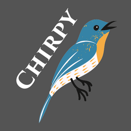
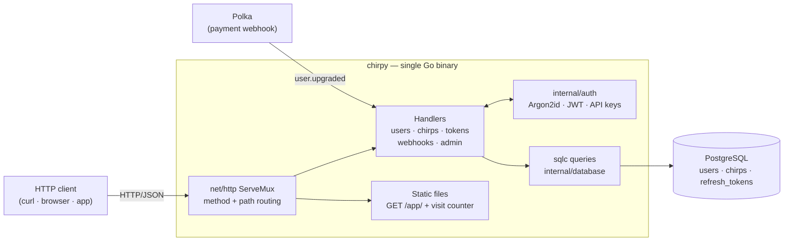
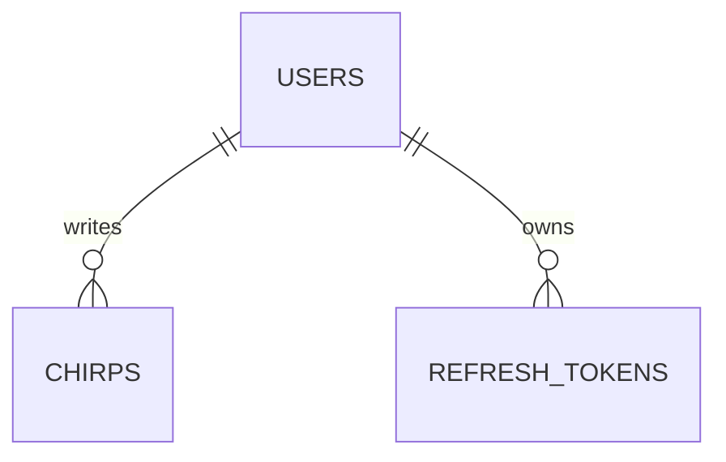

<p align="center">
  
</p>

<h1 align="center">Chirpy</h1>

<p align="center">
  <a href="https://go.dev/"></a>
  <a href="https://www.postgresql.org/"></a>
  <a href="LICENSE"></a>
</p>

A small Twitter-like JSON API built from scratch with Go's standard library. Users register, log in with JWTs, post 140-character chirps, and upgrade to Chirpy Red — all backed by PostgreSQL. Built as part of [Boot.dev's Learn HTTP Servers in Go](https://www.boot.dev/courses/learn-http-servers-golang) course.


## Features

- User registration and login with Argon2id password hashing
- JWT access tokens (1 hour) and revocable refresh tokens (60 days)
- Create, read, filter, sort, and delete chirps; only authors can delete
- 140-character limit with automatic profanity censoring
- Chirpy Red upgrades through an API-key-protected Polka webhook
- PostgreSQL persistence with Goose migrations and sqlc-generated queries
- No framework — routing and handlers use Go's `net/http`

## Tech Stack

Go · PostgreSQL · sqlc · Goose · JWT · Argon2id · lib/pq

## API

| Method | Endpoint | Auth | Description |
| --- | --- | --- | --- |
| `GET` | `/api/healthz` | — | Health check |
| `POST` | `/api/users` | — | Register a user |
| `POST` | `/api/login` | — | Log in; returns access and refresh tokens |
| `PUT` | `/api/users` | Bearer JWT | Update email and password |
| `GET` | `/api/chirps` | — | List chirps; filter with `author_id`, sort with `sort` (`asc` or `desc`, default `asc`) |
| `GET` | `/api/chirps/{chirpID}` | — | Get a single chirp |
| `POST` | `/api/chirps` | Bearer JWT | Create a chirp |
| `DELETE` | `/api/chirps/{chirpID}` | Bearer JWT | Delete your own chirp |
| `POST` | `/api/refresh` | Bearer refresh | Exchange a refresh token for a new access token |
| `POST` | `/api/revoke` | Bearer refresh | Revoke a refresh token |
| `POST` | `/api/polka/webhooks` | `ApiKey` | Upgrade a user to Chirpy Red |
| `GET` | `/admin/metrics` | — | View the file-server visit count |
| `POST` | `/admin/reset` | — | Reset users and metrics (dev only) |

`Bearer JWT` endpoints expect `Authorization: Bearer <access_token>`; `/api/refresh` and `/api/revoke` use the refresh token in the same header. The webhook uses `Authorization: ApiKey <key>`.

## How It Works



1. `main.go` loads the environment, opens PostgreSQL, and registers every route on Go's `http.ServeMux`.
2. `POST /api/users` hashes passwords with Argon2id. `POST /api/login` verifies them and returns a 1-hour JWT plus a 60-day refresh token stored in the database.
3. Protected handlers validate the JWT and use its subject as the user ID; deletes only succeed for the chirp's author.
4. Chirps are limited to 140 characters and censored before being stored through sqlc-generated queries.
5. Polka calls the webhook with an API key; a `user.upgraded` event flips `users.is_chirpy_red`.
6. `/app/` serves static files and counts visits, exposed at `/admin/metrics`; `/admin/reset` clears the counter and database in dev.

## Database Schema



The full schema lives in [`sql/schema`](sql/schema), and the queries used to generate the Go database layer live in [`sql/queries`](sql/queries).

## Run Locally

Requires [Go](https://go.dev/dl/) 1.27.4+, PostgreSQL, and the [Goose](https://github.com/pressly/goose) CLI.

```bash
git clone https://github.com/3mmarx/chirpy.git
cd chirpy
createdb chirpy
goose -dir sql/schema postgres "postgres://localhost:5432/chirpy?sslmode=disable" up
```

Create a `.env` file in the project root:

```ini
DB_URL=postgres://localhost:5432/chirpy?sslmode=disable
JWT_SECRET=change-me
POLKA_KEY=change-me
PLATFORM=dev
```

Then start the server:

```bash
go run .
```

It listens on `http://localhost:8080`; verify with `curl localhost:8080/api/healthz`. Run the tests with `go test ./...`.

`DB_URL`, `JWT_SECRET`, and `POLKA_KEY` are required. `PLATFORM=dev` enables `POST /admin/reset`; leave it unset in production. To regenerate the database layer after changing queries, run `sqlc generate`.

## License

MIT — see [LICENSE](LICENSE).
